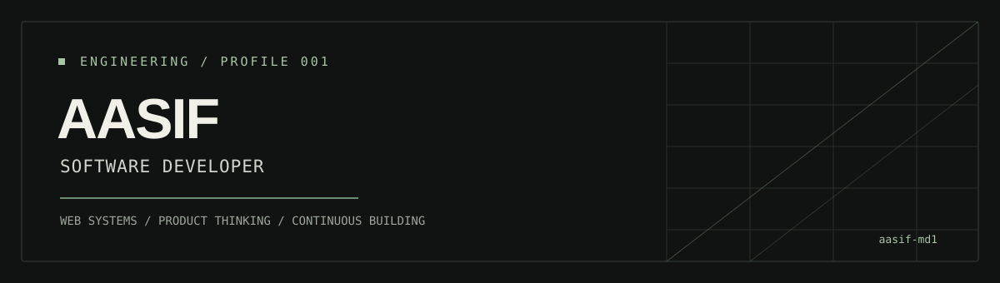

 

**Software Developer · Web Applications · Product-minded Engineering**

I build practical software with a focus on clear interfaces, useful features, and maintainable code.

 

[Portfolio](https://mdportfolio-eta.vercel.app/) · [LinkedIn](https://www.linkedin.com/in/md-aasif-7bb514305/) · [Repositories](https://github.com/aasif-md1?tab=repositories)

---

## `01 / Selected work`

<table>
  <tr>
    <td width="50%" valign="top">
      <strong><a href="https://github.com/aasif-md1/watch-party-app">Watch Party</a></strong> 
      A web project focused on bringing a shared viewing experience into one place.  
      JavaScript · Web application
    </td>
    <td width="50%" valign="top">
      <strong><a href="https://github.com/aasif-md1/ai-resume-builder">AI Resume Builder</a></strong> 
      A resume-building project exploring a more streamlined way to create application-ready documents.  
      JavaScript · AI-assisted tooling
    </td>
  </tr>
  <tr>
    <td width="50%" valign="top">
      <strong><a href="https://github.com/aasif-md1/tribhuvan_portal">Tribhuvan Portal</a></strong> 
      A college portal project designed around access to useful institutional information and workflows.  
      TypeScript · Web application
    </td>
    <td width="50%" valign="top">
      <strong><a href="https://github.com/aasif-md1/NoteSpace">NoteSpace</a></strong> 
      A notes app project built around keeping written information organised and easy to revisit.  
      Dart · Application development
    </td>
  </tr>
</table>

> Project descriptions are intentionally concise. Open each repository for its implementation, setup instructions, and current status.

## `02 / Engineering toolkit`

| Area | Tools |
|---|---|
| Languages | JavaScript, TypeScript, Python, Java, Dart |
| Frontend | React, HTML, CSS |
| Backend & data | Django, SQL, Firebase, Supabase |
| Workflow | Git, GitHub, REST APIs, deployment |

## `03 / Current approach`

- Build features that solve a specific user problem.
- Keep interfaces deliberate and implementation understandable.
- Learn by shipping projects, debugging real issues, and improving what already exists.

## `04 / Find me`

- **Portfolio:** [mdportfolio-eta.vercel.app](https://mdportfolio-eta.vercel.app/)
- **LinkedIn:** [Md Aasif](https://www.linkedin.com/in/md-aasif-7bb514305/)
- **GitHub:** [@aasif-md1](https://github.com/aasif-md1)

---

  Designed with restraint. Built around the work.

