<!-- SVGs are generated by scripts/generate.py. Edit config.json to change details. -->

  <picture>
    <source media="(prefers-color-scheme: dark)" srcset="./assets/card-dark.svg">
    <source media="(prefers-color-scheme: light)" srcset="./assets/card-light.svg">
    
  </picture>

  <picture>
    <source media="(prefers-color-scheme: dark)" srcset="./assets/stats-dark.svg">
    <source media="(prefers-color-scheme: light)" srcset="./assets/stats-light.svg">
    
  </picture>

  <picture>
    <source media="(prefers-color-scheme: dark)" srcset="./assets/snake-dark.svg">
    <source media="(prefers-color-scheme: light)" srcset="./assets/snake-light.svg">
    
  </picture>

  <a href="https://mdportfolio-eta.vercel.app/">Portfolio</a> ·
  <a href="https://www.linkedin.com/in/md-aasif-7bb514305">LinkedIn</a> ·
  <a href="https://www.instagram.com/__md_asif_01_/">Instagram</a> ·
  <a href="mailto:mdaasif18903@gmail.com">Email</a>

