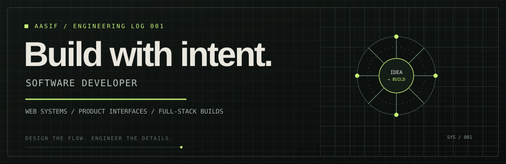
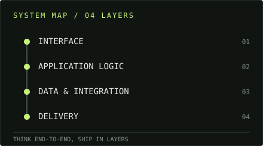
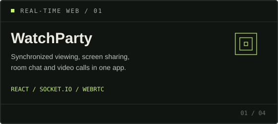
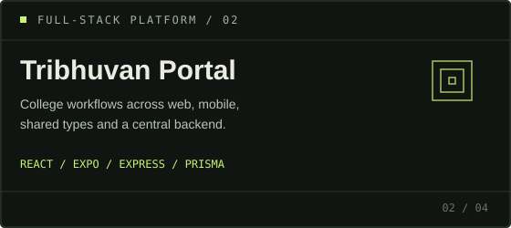
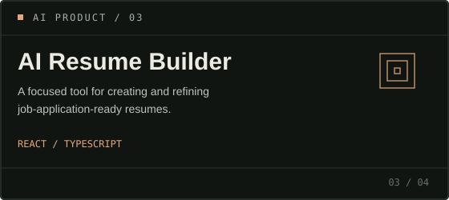
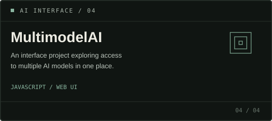
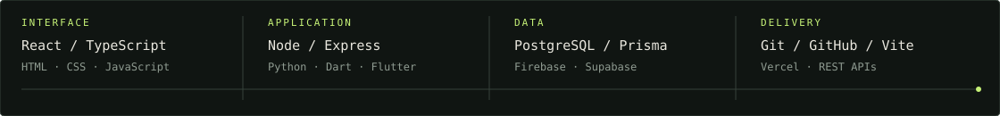

 

<a href="https://mdportfolio-eta.vercel.app/">PORTFOLIO</a>
&nbsp;&nbsp; / &nbsp;&nbsp;
<a href="https://github.com/aasif-md1?tab=repositories">REPOSITORIES</a>
&nbsp;&nbsp; / &nbsp;&nbsp;
<a href="https://www.linkedin.com/in/md-aasif-7bb514305/">LINKEDIN</a>

---

<table>
<tr>
<td width="58%" valign="top">

### `01 — PROFILE`

I’m Aasif, a software developer interested in the parts of software that make products useful: thoughtful interfaces, reliable application flows, and systems that connect the pieces together.

Most of my work is hands-on product building — from React interfaces to full-stack applications, real-time features, and mobile projects.

</td>
<td width="42%" valign="top">

</td>
</tr>
</table>

## `02 — SELECTED BUILDS`

<table>
<tr>
<td width="50%" valign="top">

</td>
<td width="50%" valign="top">

</td>
</tr>
<tr>
<td width="50%" valign="top">

</td>
<td width="50%" valign="top">

</td>
</tr>
</table>

<strong>More work — NoteSpace and smaller experiments</strong>

- **[NoteSpace](https://github.com/aasif-md1/NoteSpace)** — a Flutter notes and to-do app with a glassmorphism interface.
- **[Portfolio](https://github.com/aasif-md1/md.portfolio)** — my personal portfolio project.

## `03 — THE TOOLCHAIN`

<table>
<tr>
<td width="25%" valign="top">

**01 / Interface**

`React`  
`TypeScript`  
`JavaScript`  
`HTML · CSS`

</td>
<td width="25%" valign="top">

**02 / Application**

`Node.js`  
`Express`  
`Python`  
`Dart · Flutter`

</td>
<td width="25%" valign="top">

**03 / Data**

`PostgreSQL`  
`Prisma`  
`Firebase`  
`Supabase`

</td>
<td width="25%" valign="top">

**04 / Delivery**

`Git · GitHub`  
`Vite`  
`Vercel`  
`REST APIs`

</td>
</tr>
</table>

## `04 — WHAT I CARE ABOUT`

- **Product clarity** — the interface should make the next step obvious.
- **End-to-end thinking** — frontend, backend, data, and deployment are connected decisions.
- **Real implementation** — build it, test the flow, find the edge cases, then improve it.

## `05 — ELSEWHERE`

[**Portfolio**](https://mdportfolio-eta.vercel.app/) &nbsp; · &nbsp;
[**GitHub repositories**](https://github.com/aasif-md1?tab=repositories) &nbsp; · &nbsp;
[**LinkedIn**](https://www.linkedin.com/in/md-aasif-7bb514305/)

DESIGNED AS A WORKSPACE, NOT A BUSINESS CARD.

