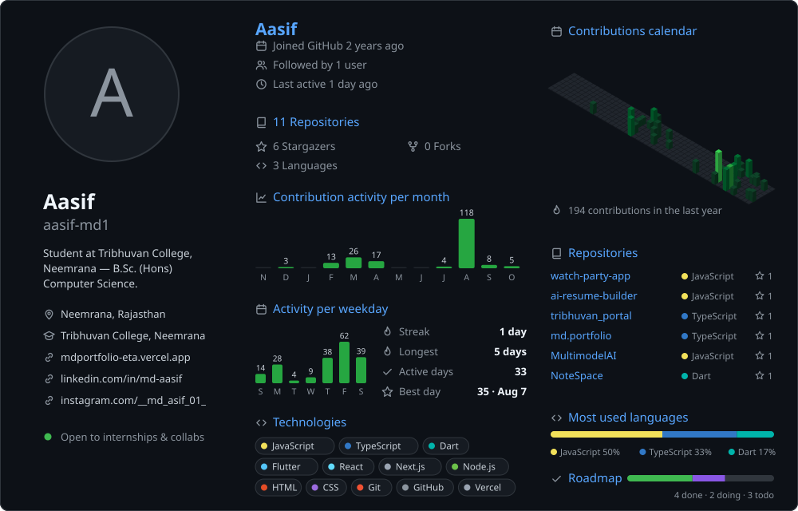

<picture>
  <source media="(prefers-color-scheme: dark)"  srcset="./assets/dashboard-dark.svg">
  <source media="(prefers-color-scheme: light)" srcset="./assets/dashboard-light.svg">
  
</picture>

<a href="https://mdportfolio-eta.vercel.app/">Portfolio</a> ·
<a href="https://www.linkedin.com/in/md-aasif-7bb514305">LinkedIn</a> ·
<a href="https://www.instagram.com/__md_asif_01_/">Instagram</a>
&nbsp;—&nbsp; dashboard refreshes itself twice a day

