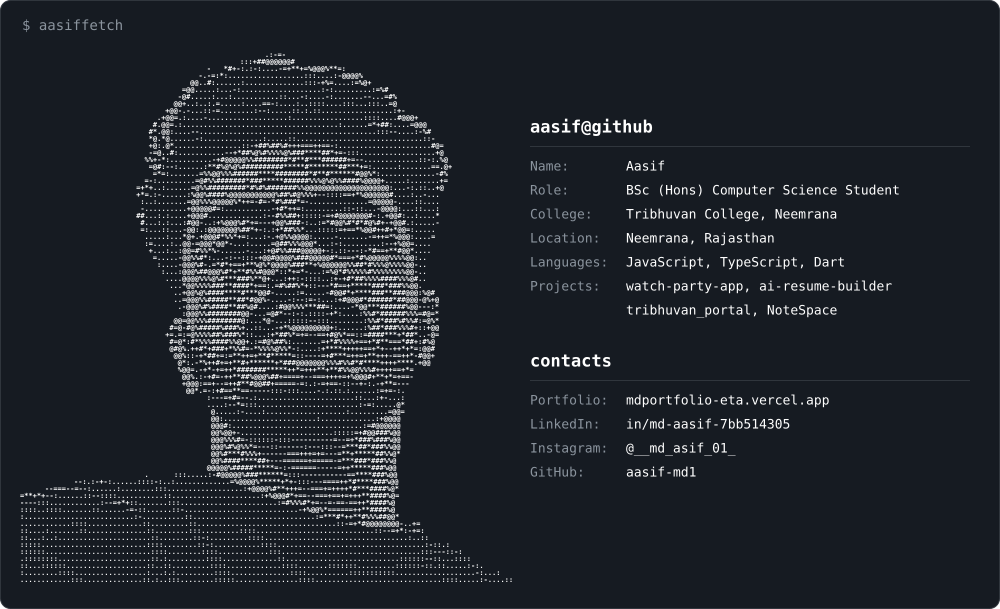
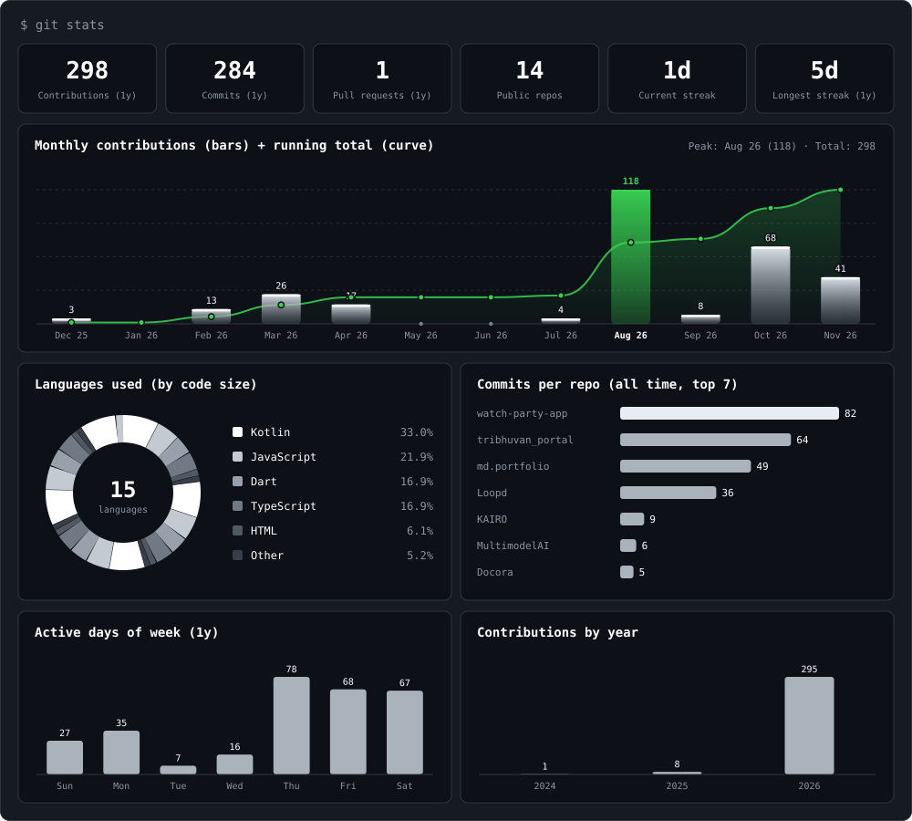

<!-- SVGs are generated by scripts/generate.py. Edit config.json to change details. -->

  <picture>
    <source media="(prefers-color-scheme: dark)" srcset="./assets/card-dark.svg">
    <source media="(prefers-color-scheme: light)" srcset="./assets/card-light.svg">
    
  </picture>

  <picture>
    <source media="(prefers-color-scheme: dark)" srcset="./assets/stats-dark.svg">
    <source media="(prefers-color-scheme: light)" srcset="./assets/stats-light.svg">
    
  </picture>

  <picture>
    <source media="(prefers-color-scheme: dark)" srcset="./assets/snake-dark.svg">
    <source media="(prefers-color-scheme: light)" srcset="./assets/snake-light.svg">
    
  </picture>

  <a href="https://mdportfolio-eta.vercel.app/"><picture><source media="(prefers-color-scheme: dark)" srcset="./assets/btn-portfolio-dark.svg"><source media="(prefers-color-scheme: light)" srcset="./assets/btn-portfolio-light.svg"></picture></a>&nbsp;&nbsp;<a href="https://www.linkedin.com/in/md-aasif-7bb514305"><picture><source media="(prefers-color-scheme: dark)" srcset="./assets/btn-linkedin-dark.svg"><source media="(prefers-color-scheme: light)" srcset="./assets/btn-linkedin-light.svg"></picture></a>&nbsp;&nbsp;<a href="https://www.instagram.com/__md_asif_01_/"><picture><source media="(prefers-color-scheme: dark)" srcset="./assets/btn-instagram-dark.svg"><source media="(prefers-color-scheme: light)" srcset="./assets/btn-instagram-light.svg"></picture></a>&nbsp;&nbsp;<a href="mailto:mdaasif18903@gmail.com"><picture><source media="(prefers-color-scheme: dark)" srcset="./assets/btn-email-dark.svg"><source media="(prefers-color-scheme: light)" srcset="./assets/btn-email-light.svg"></picture></a>

