<div align="center">


<a href="https://mdportfolio-eta.vercel.app/"></a>
<a href="https://www.linkedin.com/in/md-aasif-7bb514305"></a>
<a href="https://www.instagram.com/__md_asif_01_/">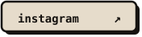</a>

</div>

### `~/whoami`

```js
const aasif = {
  name:       "Md Aasif",
  studying:   "B.Sc (Hons) Computer Science — final year",
  college:    "Tribhuvan College, Neemrana, Rajasthan",
  aiming:     ["Frontend Developer", "Full-Stack Developer", "Software Developer"],
  buildsWith: ["React", "TypeScript", "Node.js", "Flutter"],
  enjoys:     ["real-time apps", "3D on the web", "clean, polished UI"],
  openTo:     "Internships & junior roles — let's talk!",
};
```

### `~/stack`

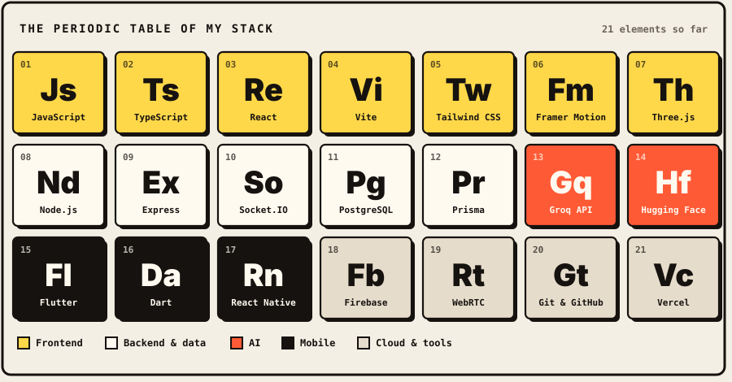

### `~/projects`

<p align="center">
  <a href="https://github.com/aasif-md1/watch-party-app">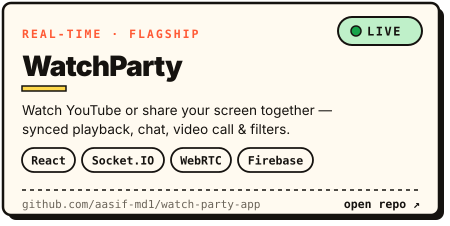</a>
  <a href="https://github.com/aasif-md1/tribhuvan_portal">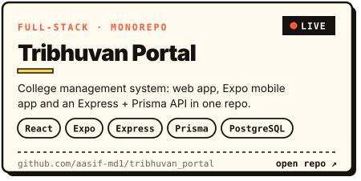</a>
  <a href="https://github.com/aasif-md1/MultimodelAI">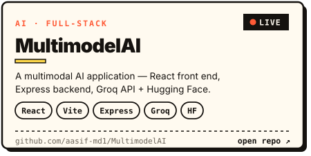</a>
  <a href="https://github.com/aasif-md1/md.portfolio">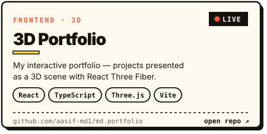</a>
  <a href="https://github.com/aasif-md1/NoteSpace">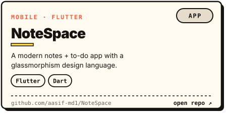</a>
  <a href="https://github.com/aasif-md1/ai-resume-builder">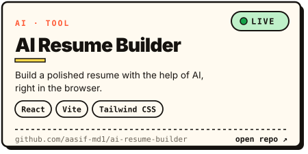</a>
</p>

<p align="center">
  <b>Live demos →</b>
  <a href="https://watchparty.website/">WatchParty</a> ·
  <a href="https://tribhuvan-portal-web.vercel.app">Tribhuvan Portal</a> ·
  <a href="https://multimodal-ai-seven.vercel.app">MultimodelAI</a> ·
  <a href="https://mdportfolio-eta.vercel.app">3D Portfolio</a> ·
  <a href="https://ai-resume-builder-iota-lake-23.vercel.app">AI Resume Builder</a>
</p>

### `~/git log --graph`

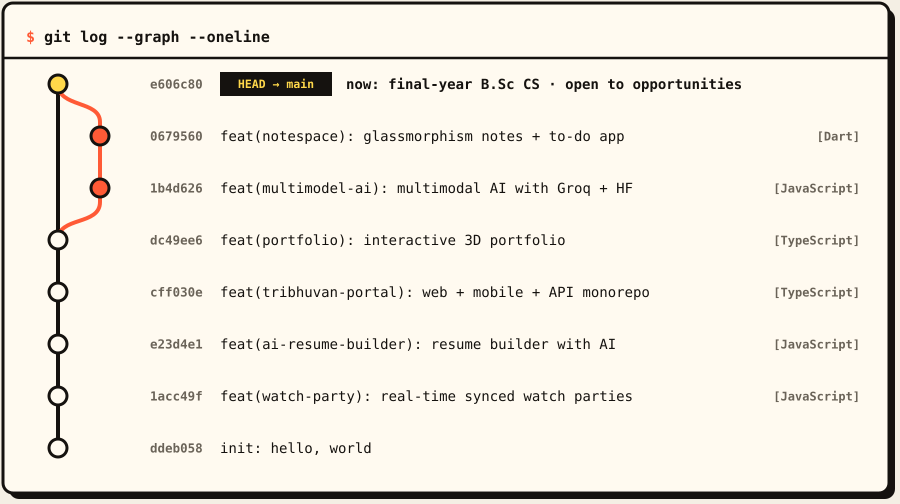

### `~/roadmap`

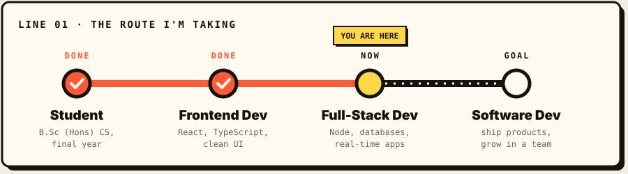

### `~/commit-bot`

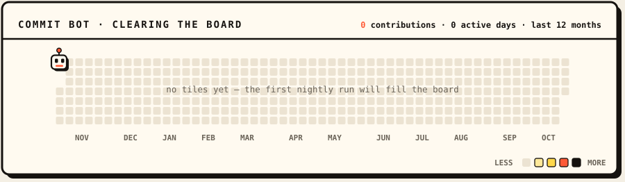

<sub>Rebuilt every night from my real GitHub activity — the bot clears one tile for every day I shipped something.</sub>

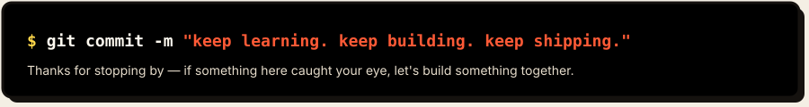
