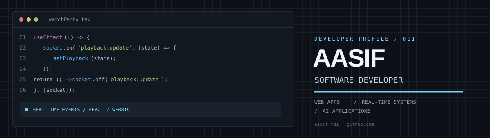

<div align="center">



<br>

<a href="https://mdportfolio-eta.vercel.app/"></a>
<a href="https://github.com/aasif-md1?tab=repositories"></a>
<a href="https://www.linkedin.com/in/md-aasif-7bb514305/"></a>

</div>

<table>
<tr>
<td width="58%" valign="top">

### `whoami`

I'm Aasif — a software developer building web applications, real-time experiences and AI-powered interfaces.

I like working across the whole feature: the UI, application state, APIs, authentication and the data behind it.

</td>
<td width="42%" valign="top">

```js
const stack = {
  frontend: ["React", "TypeScript"],
  backend: ["Node.js", "Express"],
  data: ["PostgreSQL", "Firebase"],
  realtime: ["Socket.IO", "WebRTC"]
};
```

</td>
</tr>
</table>

---

## `01 / FEATURED PROJECTS`

<table>
<tr>
<td width="50%" valign="top">

### [WatchParty ↗](https://github.com/aasif-md1/watch-party-app)

<a href="https://watchparty.website"></a>

Watch YouTube together with synchronized playback, screen sharing, room chat and video calls.

`React` `Express` `Socket.IO` `WebRTC` `Firebase Auth`

</td>
<td width="50%" valign="top">

### [Tribhuvan Portal ↗](https://github.com/aasif-md1/tribhuvan_portal)

A college platform structured as a monorepo, bringing together web, mobile, shared packages and backend services.

`React` `React Native` `TypeScript` `Express` `PostgreSQL` `Prisma`

</td>
</tr>
<tr>
<td width="50%" valign="top">

### [MultimodelAI ↗](https://github.com/aasif-md1/MultimodelAI)

A multimodal AI application with a React/Vite client and a separate Express server for model API integrations.

`React` `Vite` `Express` `Groq API` `Hugging Face`

<a href="https://multimodal-ai-seven.vercel.app/"><sub>OPEN LIVE APP ↗</sub></a>

</td>
<td width="50%" valign="top">

### [AI Resume Builder ↗](https://github.com/aasif-md1/ai-resume-builder)

A resume-building web application focused on creating and refining job-application documents.

`React` `Vite` `JavaScript` `Tailwind CSS`

<a href="https://ai-resume-builder-iota-lake-23.vercel.app/"><sub>OPEN LIVE APP ↗</sub></a>

</td>
</tr>
</table>

---

## `02 / TECH I USE`

<div align="center">


</div>

---

## `03 / GITHUB`

<div align="center">

<a href="https://github.com/aasif-md1">
  
</a>
<a href="https://github.com/aasif-md1">
  
</a>

<br>


</div>

---

<div align="center">

**Building. Breaking. Debugging. Shipping.**

[Portfolio](https://mdportfolio-eta.vercel.app/) · [All repositories](https://github.com/aasif-md1?tab=repositories) · [LinkedIn](https://www.linkedin.com/in/md-aasif-7bb514305/)

</div>
