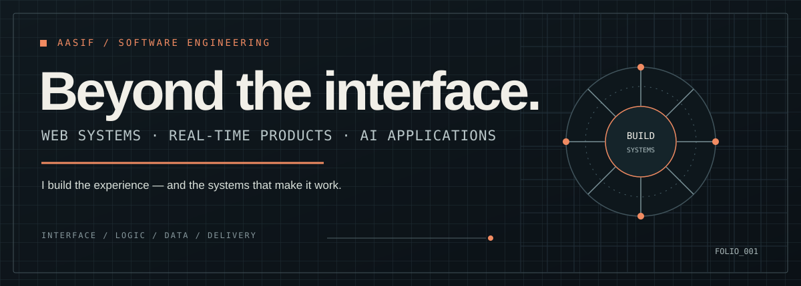
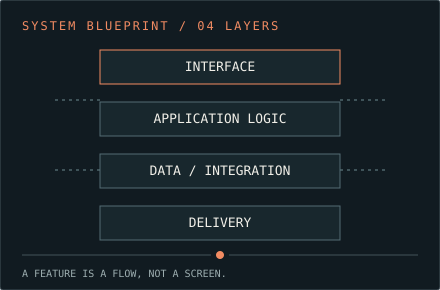
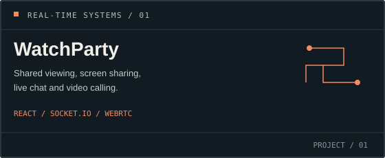
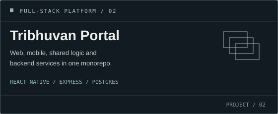
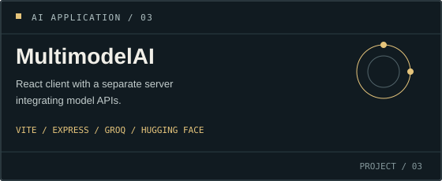
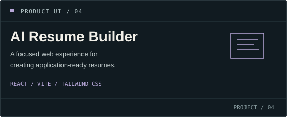
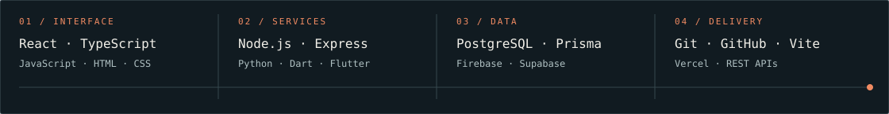

 

<a href="https://mdportfolio-eta.vercel.app/">PORTFOLIO ↗</a>
&nbsp;&nbsp;&nbsp; <a href="https://github.com/aasif-md1?tab=repositories">WORK / REPOSITORIES ↗</a>
&nbsp;&nbsp;&nbsp; <a href="https://www.linkedin.com/in/md-aasif-7bb514305/">LINKEDIN ↗</a>

 

<table>
<tr>
<td width="60%" valign="top">

01 / THE DEVELOPER

## I build the whole flow.

I'm Aasif — a software developer drawn to the space between a good interface and the system behind it.

I work across web applications, real-time experiences, AI interfaces, and full-stack products. I care about how the pieces communicate: the interaction, the API, the data, and the details users notice when everything works together.

</td>
<td width="40%" valign="top">

</td>
</tr>
</table>

---

02 / PROJECT FILES

## Selected work

<table>
<tr>
<td width="50%" valign="top">

**[WatchParty ↗](https://github.com/aasif-md1/watch-party-app)**

A synchronized viewing room with screen sharing, live chat and video calling.

React · Express · Socket.IO · WebRTC · Firebase Auth

</td>
<td width="50%" valign="top">

**[Tribhuvan Portal ↗](https://github.com/aasif-md1/tribhuvan_portal)**

A college management platform spanning web, mobile, shared logic and backend services.

React · React Native · TypeScript · Express · PostgreSQL · Prisma

</td>
</tr>
<tr>
<td width="50%" valign="top">

**[MultimodelAI ↗](https://github.com/aasif-md1/MultimodelAI)**

An AI application with a React/Vite client and a separate Express server integrating model APIs.

React · Vite · Express · Groq API · Hugging Face

</td>
<td width="50%" valign="top">

**[AI Resume Builder ↗](https://github.com/aasif-md1/ai-resume-builder)**

A focused resume-building web app, designed around turning a blank page into a usable application document.

React · Vite · JavaScript · Tailwind CSS

</td>
</tr>
</table>

<strong>More from the workbench</strong>

- **[NoteSpace](https://github.com/aasif-md1/NoteSpace)** — a Flutter notes and to-do app.
- **[Personal portfolio](https://github.com/aasif-md1/md.portfolio)** — portfolio site and project index.

---

03 / ENGINEERING TOOLKIT

<table>
<tr>
<td width="25%" valign="top">

**INTERFACE**

React  
TypeScript  
JavaScript  
HTML / CSS

</td>
<td width="25%" valign="top">

**SERVICES**

Node.js  
Express  
Python  
Dart / Flutter

</td>
<td width="25%" valign="top">

**DATA & IDENTITY**

PostgreSQL  
Prisma  
Firebase  
Supabase

</td>
<td width="25%" valign="top">

**BUILD & SHIP**

Git / GitHub  
Vite  
Vercel  
REST APIs

</td>
</tr>
</table>

---

04 / WORKING PRINCIPLES

<table>
<tr>
<td width="33%" valign="top">

**01 — Make it clear**

Interfaces should explain themselves. Good design removes friction rather than decorating it.

</td>
<td width="33%" valign="top">

**02 — Connect the layers**

A feature is more than a screen. Data, APIs, state, authentication and failure cases matter too.

</td>
<td width="34%" valign="top">

**03 — Learn by shipping**

Build, debug, observe what breaks, then make the next iteration better.

</td>
</tr>
</table>

---

<a href="https://mdportfolio-eta.vercel.app/">PORTFOLIO</a> &nbsp; / &nbsp;
<a href="https://github.com/aasif-md1?tab=repositories">ALL REPOSITORIES</a> &nbsp; / &nbsp;
<a href="https://www.linkedin.com/in/md-aasif-7bb514305/">LINKEDIN</a>

PERSONAL ENGINEERING FOLIO / AASIF-MD1

